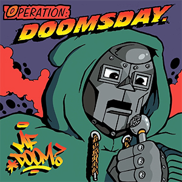
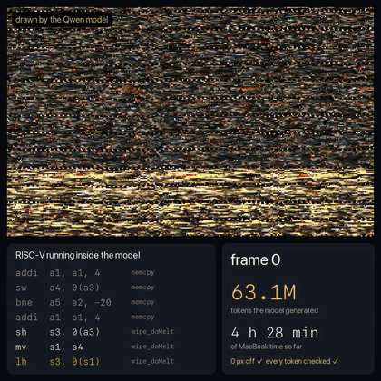
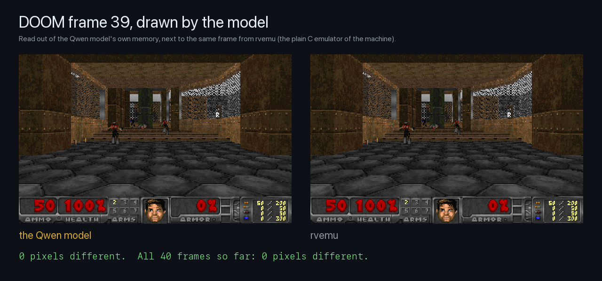
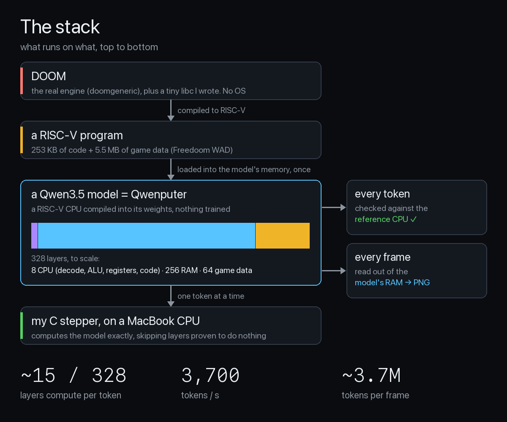
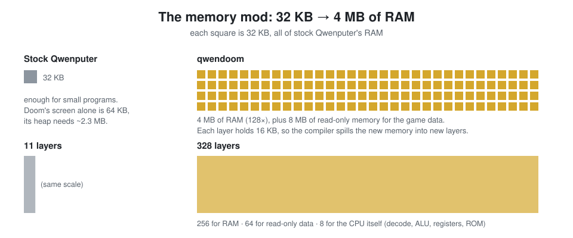
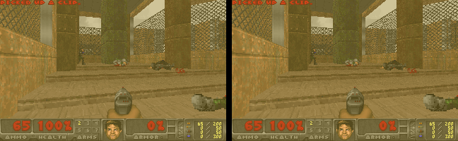
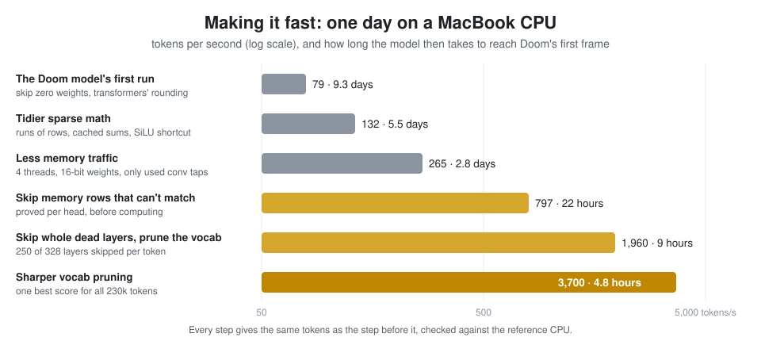
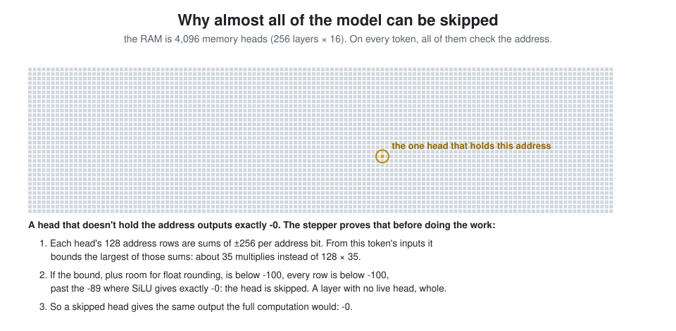
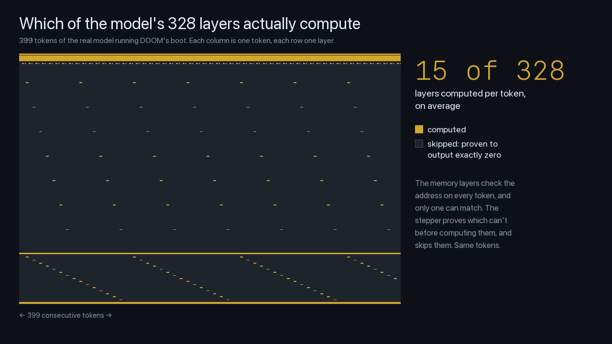
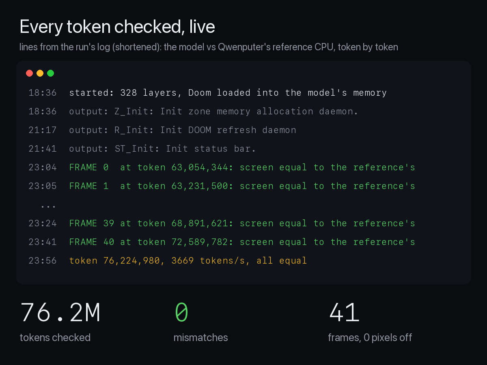

# qwendoom

**The real Doom, bare metal, running inside a Qwen model.**

The model executes every instruction of the game itself, and the whole game (code, data, heap,
screen) lives in the model's own memory. There is no OS and no disk. The host writes the game into
that memory once, before the first token. After that, its only job is to compute the model one
token at a time and feed each token back in: it never runs a Doom instruction or touches Doom's
memory again.

<p>
  
  
</p>

*First 4 seconds: frames drawn by the model, read out of its own memory, with its real token
counts and run time. Then the game playing in the emulator (same machine, labelled), with the
tokens the model would need to get there. Bottom left: RISC-V instructions Doom is running.
[Full-quality video](docs/media/hero.mp4).*



**Where it stands (Nov 5, 2026):** one continuous run on a MacBook, from Doom's first
instruction. The model booted Doom (63M tokens, 36.4M instructions) and drew its first 41 frames,
every token equal to the one Qwenputer's reference CPU (a plain Python emulator of the same
machine) produces, and every frame **0 pixels different** from the emulator's. The run stops at
the first difference. It runs at ~3,700 tokens/s, ~3.7M tokens and ~17 minutes per gameplay frame. It's paused for now and resumes from its checkpoint.
(The whole demo, 7,155 frames, would take about two months at this speed.)



```
                           Doom Generic 0.1
Z_Init: Init zone memory allocation daemon.
zone memory: 49290, 300000 allocated for zone
Using . for configuration and saves
V_Init: allocate screens.
M_LoadDefaults: Load system defaults.
...
I_Init: Setting up machine state.
```
*Doom's own startup text, printed by the model.*

---

## The idea in 30 seconds

[Qwenputer](https://github.com/divagr18/qwenputer) is a CPU written into the weights of a
model with Qwen3.5's architecture. It's not Alibaba's trained Qwen: nothing is trained. A
compiler sets every weight so that each token the model generates is a step of a RISC-V
processor (about 1.65 tokens per instruction). Its memory is the recurrent state of the model's
linear-attention layers (Gated DeltaNet): the running memory each layer carries from token to
token.

To run a program, the host writes the program and its data into that state once, before the
first token, and then lets the model generate. That's how Qwenputer loads every program, and it
happens once: after that, nothing outside touches the machine's memory.

Stock Qwenputer has 32 KB of RAM. Doom needs megabytes. This repo gives the machine 4 MB of
RAM and 8 MB of read-only data memory, compiles the real Doom for it, and runs it on the model.

---

## Timeline

### Nov 2–4: where it started (a different machine)

On [qwenGPU](https://github.com/vixhal-baraiya/qwenGPU), a small GPU compiled into Qwen3.5-2B, I
ran a 5,296-parameter name generator: 1 h 43 min to write one letter. The compiled weights were
99.9% zeros, so I wrote a "stepper", a small C program that computes the same layers but skips
the zeros, with the same rounding: 9 → 2,058 tokens/s
([details](https://github.com/utsav1033/qwenGPU/tree/main/tiny)). The Doom project uses the same
idea, rewritten for this much bigger model.

### Nov 5, 1 am: can it run Doom? Not with 32 KB.

Doom's screen alone is 64 KB, and its heap (the memory it allocates while running) needs
~2.3 MB. So the machine had to grow first.



In Qwenputer, a layer holds 16 KB of RAM or 128 KB of read-only data in its state. Asking the
compiler for 4 MB of RAM plus 8 MB of read-only data makes it spill the memory into more layers:
**11 → 328 layers**. (Doom's code goes in a separate 256 KB code ROM, the same as stock.) The
original 32 KB machine still builds and passes its tests.

### Nov 5, early morning: real Doom, compiled for the machine

- [doomgeneric](https://github.com/ozkl/doomgeneric), the original Doom engine made easy to
  port, compiled to RISC-V. A tiny C standard library (libc) written for it: memory allocation,
  strings, printf. No OS.
- The game data file (a "WAD") is [Freedoom](https://freedoom.github.io)'s, cut down to the map
  of the game's built-in demo (a recorded playthrough Doom replays), 5.5 MB. It sits in the
  read-only data memory, where Doom reads it as if from a file.
- A fast C emulator of the exact same machine (`tools/rvemu.c`) plays the whole demo, 7,155
  frames and 11.5 billion instructions, in 21 seconds. Its frames match Doom built for the Mac,
  0 pixels different (checked at frames 300 and 7,000):



*Frame 300 of the demo. Left: Doom built for the Mac. Right: the RISC-V build the model runs,
**in the emulator, not the model**. This is what the model's first frames should look like.*

> **`rvemu`** is a normal C program that acts as the same RISC-V machine, without the model.
> It plays the whole demo in 21 seconds; the model would take about two months. It says nothing
> about the model. We use it to test the Doom build, to measure it, and to save the machine's
> exact memory at any point in the game.

### Nov 5, 1:30 pm: Doom boots on the model

Written out as ordinary dense weights, the 328 layers would be tens of billions of numbers. We
keep only the nonzero ones: 43.9M, 520 MB. The stepper computes what `transformers`' Qwen3.5
decode step computes, with the same bf16 rounding, from those. (We haven't run the 328-layer
model in `transformers` itself, since it's too big as dense weights; the check is that every
token equals the reference CPU's.) It ran Doom's boot at **79 tokens/s**: **9 days** to the first
frame.

### Nov 5, afternoon: from 9 days to under 5 hours



The first steps cut memory traffic. Most of the speedup comes from this: on every token,
all 4,096 memory heads (one head holds 1 KB of RAM) check the address, and at most one can match.



The stepper doesn't guess which heads are dead: it proves it from the inputs, with room for
float rounding, so a skipped head's output is what the full computation gives. The same trick
prunes the output layer: of 230,336 possible next tokens, it scores only the few blocks of them
that could win. Late in the boot, only ~15 of the 328 layers compute per token:



Three things we measured:

- **4 threads gave 2% at first.** Each token read most of the weights from memory, and the
  4 cores share one memory bus. Reading less (16-bit weights, only the conv taps in use) helped;
  skipping work helped most.
- **Doom's demo touches 3.19 MB of the RAM and 4.07 MB of the data memory** (`rvemu -touch`).
  71 of the 328 layers are never used. Removing them would give ~1.25×. Per-token skipping
  gives more, since each token touches one address.
- **A frame is ~1.6M instructions × ~1.65 tokens ≈ 2.5M tokens.**

### Nov 5, 6:36 pm → 11:24 pm: the run, and the first frames

`model/run.py` runs Doom on the model from its first instruction and checks every token. It
saves a checkpoint every 15 minutes and can resume. At each frame, it reads the screen and the
palette straight out of the model's RAM, checks them against the reference CPU's RAM, and saves
a PNG: it only reads bytes the model has already written.

The boot took 4 h 28 min (63.05M tokens, 36.37M instructions). Then the first 40 frames came in 20 minutes: the melt
frames are cheap, since Doom only slides columns of the old screen down. Frame 39 is the first
clean frame of the level.

### Nov 6–7: the model compiles and runs C

Same model, same weights, a different program in its memory:
[c4](https://github.com/rswier/c4), a C compiler in about 500 lines. c4 compiles C to code for
its own small stack VM and then runs it, so one program does both. It can compile itself.

`mandel.c` draws the Mandelbrot set in text. c4 has no floats, so it uses fixed point
(4096 = 1.0). The model ran c4, c4 compiled `mandel.c` and ran it, and the model printed this
one row at a time:

```
          ..............::::::-+@=-:::..
         .............::::::--@@@@=:::::
         ...........:::::*+=++#@@@+*--+:
        .........::::::--+@@@@@@@@@@@@@-
        ......::--------*@@@@@@@@@@@@@@-
       ...:::::--@@*@@++@@@@@@@@@@@@@@@*
       .:::::::-+@@@@@@%@@@@@@@@@@@@@@@+
       ::-----+@@@@@@@@@@@@@@@@@@@@@@@@-
       ::-----+@@@@@@@@@@@@@@@@@@@@@@@@-
       .:::::::-+@@@@@@%@@@@@@@@@@@@@@@+
       ...:::::--@@*@@++@@@@@@@@@@@@@@@*
        ......::--------*@@@@@@@@@@@@@@-
        .........::::::--+@@@@@@@@@@@@@-
         ...........:::::*+=++#@@@+*--+:
         .............::::::--@@@@=:::::
          ..............::::::-+@=-:::..
exit(0) cycle = 316370
```

7,254,293 tokens (4.97M instructions) in 29 minutes on a MacBook CPU, every token equal to the
reference CPU's, the output identical to the emulator's. c4 needs about 1.25 MB of buffers, so
it doesn't fit the stock 32 KB machine either.

Two changes made it 34% cheaper, with the same output for every test program:
`c4/c4-fuse.patch` fuses c4's commonest VM op pairs after compiling (load a local, push a
constant), and c4's 768 KB of startup zeroing uses an unrolled memset.

| program, in the emulator | stock c4 | now |
|---|---:|---:|
| `hello.c` | 795K instructions | 255K |
| `mandel.c` | 7.57M | 4.97M |
| c4 compiling c4, which compiles `hello.c` | 3.82M | 3.00M |

---

## What's done, what's not

| | |
|---|---|
| ✅ RAM mod: 4 MB RAM, 8 MB read-only memory, 328 layers | stock map unchanged, tests pass |
| ✅ Real Doom compiled for the machine | the whole demo plays in the emulator, same pixels as native |
| ✅ The model runs Doom's boot | every token so far equal to the reference CPU's |
| ✅ Reading memory back out of the model | equal to the reference machine's RAM |
| ✅ Frames drawn by the model | 41 so far, 0 pixels different from the emulator (the run is paused, resumable) |
| ✅ A C compiler on the model | c4 compiled and ran `mandel.c`: 7.25M tokens, all equal, same output as the emulator |
| ⏳ Faster | ~270 µs per token now: about a third is the RISC-V CPU's own circuit, the rest overhead |



**What "inside the model" means here:** the program and its data are written into the model's
memory once, before the first token, like flashing a chip. After that, every token is the
model's own greedy prediction from the token before.

---

## Run it yourself

Needs a Mac or Linux machine, `uv`, Python 3.12+ with numpy, and a C compiler.

```bash
curl -LO https://github.com/freedoom/freedoom/releases/download/v0.13.0/freedoom-0.13.0.zip
unzip -j freedoom-0.13.0.zip freedoom-0.13.0/freedoom1.wad
git clone https://github.com/ozkl/doomgeneric port/build/doomgeneric   # wad.py reads its texture tables
git -C port/build/doomgeneric checkout e257a09
python port/wad.py freedoom1.wad port/build/doom.wad
port/build.sh                                 # Doom for the machine: port/build/doom.elf
mkdir -p tools/build && cc -O2 tools/rvemu.c -o tools/build/rvemu
tools/build/rvemu port/build/doom.elf -q      # the whole demo in the emulator, in seconds
QWENPUTER_MAP=doom PYTHONPATH=qwenputer python model/pack.py      # the model (~4 min, 520 MB)
QWENPUTER_MAP=doom PYTHONPATH=qwenputer python model/stepper.py port/build/doom.elf --tokens 8000 --check
QWENPUTER_MAP=doom PYTHONPATH=qwenputer python model/run.py port/build/doom.elf   # the long run
```

c4 (after the model is packed):

```bash
c4/build.sh mandel '"c4", "mandel.c"'          # c4 for the machine, running mandel.c from its ROM disk
tools/build/rvemu c4/build/c4-mandel.elf       # in the emulator
QWENPUTER_MAP=doom PYTHONPATH=qwenputer python model/run.py c4/build/c4-mandel.elf --dir model/build/c4-mandel
```

## What's in the repo

| | |
|---|---|
| `qwenputer/` | Qwenputer's RISC-V machine, with the Doom memory map added (`QWENPUTER_MAP=doom`) |
| `port/` | Doom's platform layer for the machine (video, clock, the WAD as a ROM disk), the libc, the linker map, the WAD cutter, the build |
| `tools/rvemu.c` | a fast C emulator of the same machine. `-touch` records every address a run uses |
| `tools/refcheck.py` | the reference machine at instruction N, to compare against the emulator |
| `model/pack.py` | builds the model and keeps its nonzero weights |
| `model/stepper.c` | runs the model, one token at a time, exactly (the speed is here) |
| `model/run.py` | the long run: every token checked, checkpoints, frames |
| `c4/` | c4 for the machine: a ROM disk of C sources, the op-fusion patch, test programs |

<details>
<summary><b>The stepper's tricks, in detail</b></summary>

Each one leaves the tokens unchanged. Glossary: a *head* is one attention unit (here, one
block of memory); *bf16* is the 16-bit float format the model uses; *SiLU* is the activation
function, x / (1 + e^-x), which is exactly −0 for x below about −89; *conv taps* are the 4 weights
of each channel's short convolution over recent tokens.

| step | tokens/s |
|------|---------:|
| skip zero weights and zero inputs, SIMD runs of rows, transformers' bf16 rounding points | 79 |
| ballast sums cached, `silu(x < -89) = -0` | 132 |
| 4 threads per layer, each product reads only its inputs, bf16 weights, conv reads only its taps | 265 |
| skip address rows that provably can't match | 797 |
| skip whole dead layers; the output head by bounded token blocks | 1,960 |
| one vocabulary-wide best for the head; groups of blocks; zero dims left out | 3,700 |

**The bound.** For each attention head's 128 query (or key) channels, the stepper takes, per
input, the smallest and largest weight over the rows. That bounds every row's sum from this
token's inputs. A row's bias is a constant plus a part per address bit, so that part is folded
into the bit's columns, and columns that split the rows the same way are taken together. Then
the bound is the exact maximum over the rows. The float error of a sum of n terms is at most
(n + 1)·2⁻²⁴·Σ|terms|. A head whose bound plus that is below −100 is all −0 after the conv and
SiLU, and is skipped.

**Writes.** A head's keys come from the previous token, so a head whose keys were dead last
token can't write now. Values are computed only for a head that can write. Their conv history
is recomputed from the last 3 tokens' inputs, which are kept (and checkpointed).

**Whole layers.** If no head can read, none wrote last token, the state doesn't decay and there
is no MLP, the layer changes nothing, and every thread skips it without syncing.

**The output head.** It bounds blocks of 64 tokens (and groups of 64 blocks), scores the most
promising first, then only blocks whose bound could reach the best score. The margin is float
error plus one bf16 step; ties go to the lowest token number, as in the full argmax.

</details>

## Credits and licenses

- [Qwenputer](https://github.com/divagr18/qwenputer) by Divyansh Agrawal, MIT (`qwenputer/LICENSE`).
- [doomgeneric](https://github.com/ozkl/doomgeneric) by ozkl, GPL-2.0. Fetched at a pinned commit, not included.
- [Freedoom](https://freedoom.github.io), BSD. Downloaded, not included.
- [c4](https://github.com/rswier/c4) by Robert Swierczek, GPL-2.0. Fetched at a pinned commit, not included.
- [qwenGPU](https://github.com/vixhal-baraiya/qwenGPU) by vixhal-baraiya, where this started.
- The stepper idea is the same as [Locals](https://github.com/Generated-Computers/Locals)' stepper for Qwenputer.
- Everything else here (`port/`, `tools/`, `model/`, `c4/`) is GPL-2.0, because the port links doomgeneric (`LICENSE`).
